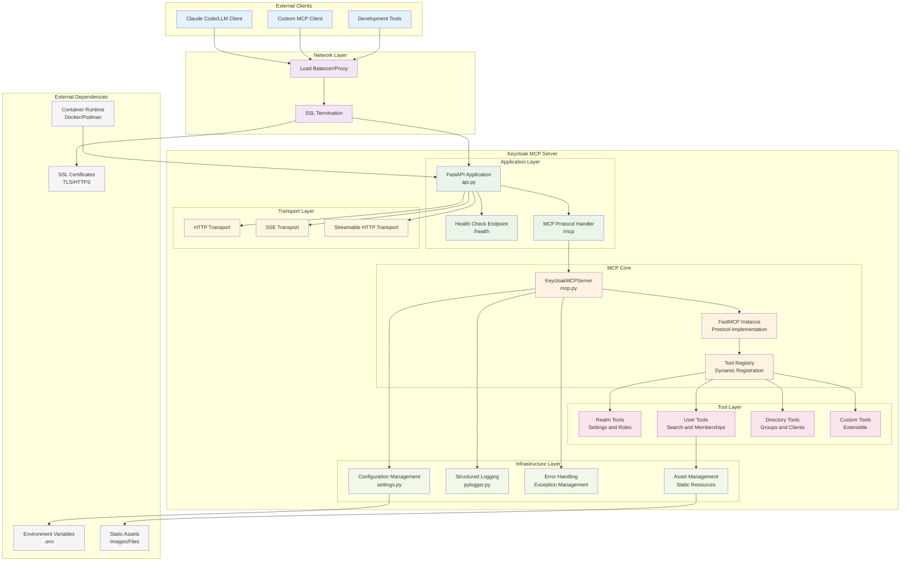
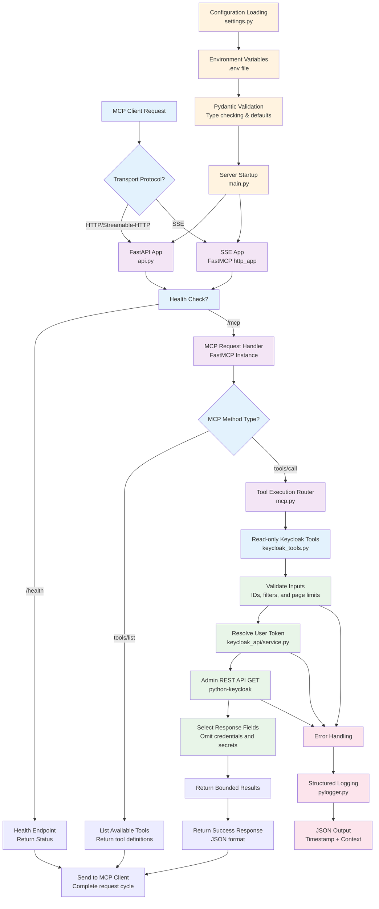

# Architecture

## System Architecture



## Control Flow



## Code Structure

```
keycloak-mcp-server/
├── keycloak_mcp_server/           # Main package directory
│   ├── __init__.py
│   ├── src/                       # Core source code
│   │   ├── __init__.py
│   │   ├── main.py               # Application entry point & startup logic
│   │   ├── api.py                # FastAPI application & transport setup
│   │   ├── mcp.py                # MCP server implementation & tool registration
│   │   ├── settings.py           # Pydantic-based configuration management
│   │   ├── assets/               # Static resource files (none yet)
│   │   ├── keycloak_api/         # Keycloak integration
│   │   │   ├── __init__.py
│   │   │   ├── auth.py           # Stateless Keycloak token verification
│   │   │   └── service.py        # Request-scoped Admin API connections
│   │   └── tools/                # MCP tool implementations
│   │       ├── __init__.py
│   │       └── keycloak_tools.py # Twenty read-only Keycloak tools
│   └── utils/                    # Shared utilities
│       ├── __init__.py
│       └── pylogger.py          # Structured logging with structlog
├── tests/                        # Comprehensive test suite
│   ├── conftest.py              # Pytest fixtures and configuration
│   ├── test_api.py              # API endpoint tests
│   ├── test_basic.py            # Basic integration tests
│   ├── test_main.py             # Entry point tests
│   ├── test_mcp.py              # MCP server tests
│   ├── test_settings.py         # Configuration tests
│   ├── test_keycloak.py         # Tools against simulated Admin API responses
│   ├── test_keycloak_oauth.py   # Signed-token auth against simulated Keycloak
│   └── test_utils.py            # Utility tests
├── examples/                     # Client examples
│   ├── fastmcp_client.py        # FastMCP client example
│   ├── keycloak_client.py       # Direct smoke test, with optional browser sign-in
│   └── langgraph_client.py      # LangGraph client example
├── deployment/                   # Deployment configurations
│   └── openshift/               # OpenShift manifests
├── .github/                      # GitHub configuration
│   ├── ISSUE_TEMPLATE/          # Issue templates
│   ├── PULL_REQUEST_TEMPLATE.md # PR template
│   ├── dependabot.yml           # Dependency automation
│   ├── labeler.yml              # Auto-labeling rules
│   └── workflows/               # CI/CD workflows
├── pyproject.toml               # Project metadata & dependencies
├── Makefile                     # Development commands
├── Containerfile                # UBI Python 3.12 container build
├── compose.yaml                 # Podman/Docker Compose orchestration
├── CONTRIBUTING.md              # Contribution guide
├── SECURITY.md                  # Security policy
├── CHANGELOG.md                 # Release history
├── LICENSE                      # Apache 2.0
└── README.md                    # Project documentation
```

## Key Components

- **`main.py`**: Application entry point with configuration validation, error handling, and uvicorn server startup
- **`api.py`**: FastAPI application setup with transport protocol selection (HTTP/SSE/streamable-HTTP) and health endpoints
- **`mcp.py`**: Core MCP server class that registers tools using FastMCP decorators
- **`settings.py`**: Environment-based configuration using Pydantic BaseSettings with validation
- **`tools/keycloak_tools.py`**: Read-only Keycloak tool schemas, pagination, and selected response fields
- **`keycloak_api/service.py`**: Request-scoped user tokens and asynchronous Admin API GET requests
- **`keycloak_api/auth.py`**: RFC 9728 resource server: verifies each request's Keycloak access token (JWKS, issuer, audience, `azp`) and accepts gateway-exchanged tokens; stores nothing (see [Authentication Guide](authentication.md))
- **`utils/pylogger.py`**: Structured JSON logging using structlog with comprehensive processors

## Current MCP Tools

There are twenty read-only tools covering realm settings, users, groups, clients,
roles, client scopes and mappers, events, sessions, token previews and LDAP federation.
See [Keycloak tools](keycloak-tools.md) for configuration, response fields, and pagination.

## HTTP Endpoints

The FastAPI application (`api.py`) exposes the following HTTP routes. The protected resource metadata is registered only when `ENABLE_AUTH=True`.

### Core Routes

| Method | Path | Description |
|--------|------|-------------|
| `GET` | `/health` | Health check — returns `{"status": "healthy"}` |
| `POST` | `/mcp` | MCP JSON-RPC endpoint (tools/list, tools/call, etc.) |
| `GET` | `/.well-known/oauth-protected-resource/mcp` | RFC 9728 protected resource metadata naming the Keycloak realm (auth only) |

There are no authorization, token, callback or registration routes: MCP clients
sign users in at Keycloak itself. The MCP endpoint requires a Keycloak access token
for both discovery and calls when `ENABLE_AUTH=True`. `/health` and the protected
resource metadata remain public.

## Error Handling

The server uses a layered error handling strategy:

| Layer | Mechanism | Example |
|-------|-----------|---------|
| **Startup** | `main.py` validates settings and catches `SystemExit`, `KeyboardInterrupt`, and unexpected exceptions before the event loop starts | Missing required env var → logged + exit(1) |
| **Middleware** | FastMCP verifies each Keycloak access token against the realm's JWKS, rejecting invalid or missing credentials with `401` and the metadata URL | Expired bearer token → `401` |
| **Health** | `/health` returns `200` with `{"status": "healthy"}` — no auth required | Used by container probes and load balancers |
| **Tool-level** | Each MCP tool validates its own inputs (type checks, value ranges) and raises descriptive errors that the MCP protocol returns to the client | `search_users` with `max_results=101` → error message in MCP response |
| **Logging** | All layers log via structlog with JSON output, including request IDs and error context | Structured `error` level entries with stack traces |
