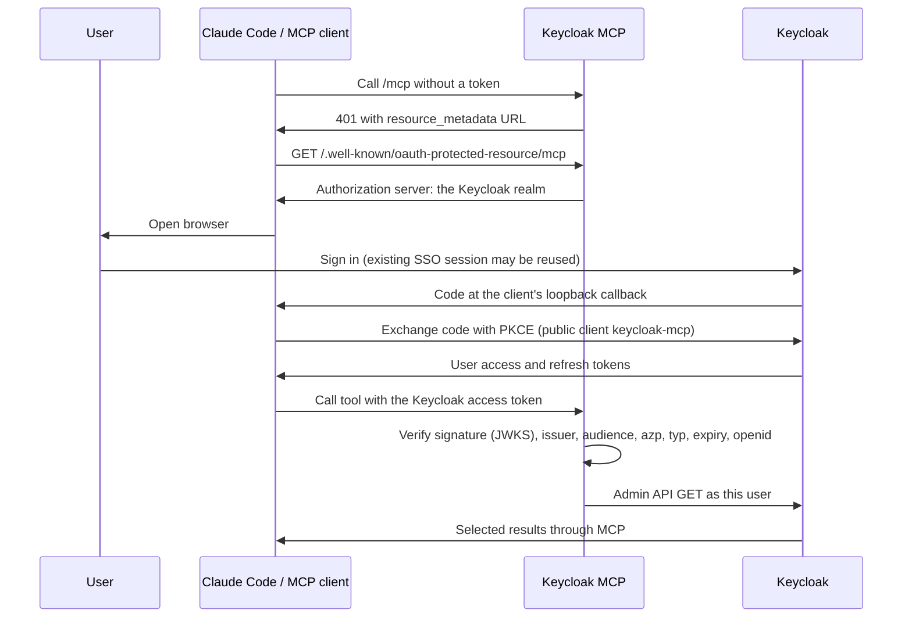

# Browser sign-in with Keycloak

Two modes, both using each user's own Keycloak token:

- **stdio**: the MCP client launches the server (`uvx keycloak-mcp-server --stdio`) and
  the server signs its one local user in through the browser itself (RFC 8252 native-app
  flow: PKCE S256, random state, callback on `127.0.0.1`). Tokens are cached in a `0600`
  file and refreshed. See the [README](../README.md#use-with-claude-code-stdio-no-server-to-run).
- **HTTP** (the rest of this guide): one stateless server for many users. Keycloak is the
  authorization server; this server only validates the tokens it issues.

In HTTP mode the server is an OAuth resource server. It publishes
[RFC 9728](https://www.rfc-editor.org/rfc/rfc9728) protected resource metadata naming
your Keycloak realm, so the MCP client signs the user in to Keycloak directly in the
browser and sends the Keycloak access token with each request. The server stores
nothing: no tokens, sessions, or signing keys, so any number of replicas can serve the
same users.

## Flow



The MCP client refreshes the token with Keycloak itself. The server never logs in as
a service account or retries with another identity.

The MCP client holds the Keycloak access token, and the server sends that same token
to the Admin API. A copy of it can therefore be used against the Admin API directly,
with the user's own permissions, until it expires. Keep access-token lifetimes short
and grant users only the `realm-management` roles they need.

## Register the Keycloak client

MCP clients sign in with one pre-registered public client, `keycloak-mcp`:

| Setting | Value |
| --- | --- |
| Access type | Public (client authentication disabled) |
| Standard flow | Enabled |
| PKCE method | S256 |
| Refresh tokens | Enabled |
| Implicit flow, direct access grants, service accounts | Disabled |
| Valid redirect URIs | `http://localhost:9876/*` (Claude Code's `--callback-port`), `http://127.0.0.1:8250/callback` (stdio mode) |
| Default client scopes | `profile`, `email`, `roles` |
| Access-token audience mapper | `keycloak-mcp`, the client's own ID (access token only) |

Example with the [Keycloak Terraform provider](https://registry.terraform.io/providers/keycloak/keycloak/latest/docs):

```hcl
resource "keycloak_openid_client" "keycloak_mcp" {
  realm_id  = "myrealm"
  client_id = "keycloak-mcp"
  name      = "Keycloak MCP"

  access_type                  = "PUBLIC"
  standard_flow_enabled        = true
  implicit_flow_enabled        = false
  direct_access_grants_enabled = false
  pkce_code_challenge_method   = "S256"
  full_scope_allowed           = true

  valid_redirect_uris = [
    "http://localhost:9876/*",        # HTTP mode: Claude Code --callback-port 9876
    "http://127.0.0.1:8250/callback", # stdio mode: the server signs you in itself
  ]
}

# Put the client itself in `aud` so the server only accepts tokens minted for it.
resource "keycloak_openid_audience_protocol_mapper" "keycloak_mcp_audience" {
  realm_id                 = "myrealm"
  client_id                = keycloak_openid_client.keycloak_mcp.id
  name                     = "keycloak-mcp-audience"
  included_client_audience = keycloak_openid_client.keycloak_mcp.client_id
  add_to_access_token      = true
  add_to_id_token          = false
}
```

No client secret is required. The redirect URIs are the MCP clients' own loopback
callbacks, so each MCP client must use a fixed callback port that is registered here.

Keep the audience mapper on this client, not on a realm default client scope: a
default-scope mapper would put `keycloak-mcp` into every client's tokens.

MCP clients that cannot be given a client ID try Keycloak's dynamic client registration
instead. Keycloak's default anonymous-registration policy (trusted hosts) usually
refuses it, and a self-registered client would not get the audience mapper above, so
use clients that accept a pre-registered client ID.

Full scope allowed forwards the user’s existing role mappings into the token.
The client assigns no roles. The MCP tools perform GET requests only, but the user token
retains that user’s existing permissions. Users still need the corresponding
`realm-management` view/query permissions or fine-grained Admin API authorization.
A successful login alone does not grant access to realm, user, group, or client data.

## Configure the server

Copy `.env.example` to `.env` if it does not already exist, then set:

```dotenv
ENABLE_AUTH=True
MCP_HOST_ENDPOINT=http://localhost:5001
KEYCLOAK_SERVER_URL=https://keycloak.example.com
KEYCLOAK_REALM=myrealm
KEYCLOAK_OAUTH_CLIENT_ID=keycloak-mcp
KEYCLOAK_OAUTH_AUDIENCE=keycloak-mcp
# KEYCLOAK_CA_BUNDLE=/path/to/trusted-ca-bundle.pem
```

`MCP_HOST_ENDPOINT` is the public origin MCP clients reach, without `/mcp`; it becomes the
`resource` in the protected resource metadata. Remove `KEYCLOAK_DEV_ACCESS_TOKEN`; the MCP
client opens the browser. Startup rejects missing configuration, an empty audience, a
non-HTTPS Keycloak URL, or an insecure non-loopback HTTP origin. No database or
persistent storage is required.

TLS verification is enabled for JWKS lookup and Admin API requests. If the system does
not trust your Keycloak's certificate issuer (for example a private CA), set
`KEYCLOAK_CA_BUNDLE` to a PEM bundle containing the trusted issuer certificates.

Your realm's discovery document is:

```text
https://keycloak.example.com/realms/myrealm/.well-known/openid-configuration
```

`KEYCLOAK_SERVER_URL` is the base URL before `/realms`; do not append `/admin/realms`
or an OIDC endpoint. Current Keycloak serves realms at the root; legacy WildFly
distributions and some deployments add an `/auth` context path, which must then be
part of the base URL.

Restart with `make local`, then follow the [Claude Code commands](../README.md#use-with-claude-code-http).

## Validation

Every request's token is verified locally: RS256 signature against the realm’s JWKS,
issuer, audience (`KEYCLOAK_OAUTH_AUDIENCE`), authorized party
(`azp` = `KEYCLOAK_OAUTH_CLIENT_ID`), access-token type (`typ=Bearer`), subject, expiry,
not-before, and the `openid` scope. Tokens other clients of the realm obtained are
refused even if they carry this server's audience. Realm logout or revocation is not
checked by introspection on every call and takes effect at token expiry.

`tests/test_keycloak_oauth.py` sends real signed tokens through the HTTP app against
simulated Keycloak endpoints: protected resource metadata, two concurrent user
identities, permissions, invalid claims, untrusted clients, token exchange, startup
validation, and CA trust. This does not replace a live browser login test.

## Gateways and token exchange (RFC 8693)

An MCP gateway such as [ContextForge](https://github.com/IBM/mcp-context-forge) can sign
users in to Keycloak with the same browser flow and exchange their token for one
addressed to this server, so users sign in once for every server behind the gateway.
Allow the gateway's Keycloak client:

```dotenv
KEYCLOAK_TRUSTED_EXCHANGERS=["mcp-context-forge"]
```

The server then also accepts Keycloak access tokens that are signed by the realm,
include `KEYCLOAK_OAUTH_AUDIENCE` in `aud`, and have one of these clients as `azp`
(after a standard token exchange, `azp` is the client that performed it). The token is
forwarded to the Admin API unchanged, so Keycloak still authorizes the original user.
`KEYCLOAK_OAUTH_CLIENT_ID` may not be listed as an exchanger.

On the Keycloak side:

- The client users sign in to the gateway with must put the gateway's client ID in
  `aud`; standard token exchange requires the exchanging client in the subject token's
  audience.
- The gateway's client is confidential, with standard token exchange enabled.
- An optional client scope on the gateway's client adds `keycloak-mcp` to `aud`; the
  gateway requests it during the exchange.

A ContextForge gateway entry for this server:

```json
{
  "name": "keycloak-mcp",
  "url": "https://keycloak-mcp.example.com/mcp",
  "auth_type": "oauth",
  "oauth_config": {
    "grant_type": "token-exchange",
    "token_url": "https://keycloak.example.com/realms/myrealm/protocol/openid-connect/token",
    "client_id": "mcp-context-forge",
    "client_secret": "<secret>",
    "target_audience": "keycloak-mcp",
    "scopes": ["exchange-keycloak-mcp"]
  }
}
```

ContextForge exchanges the bearer token it received, so the MCP client must reach
ContextForge with a Keycloak access token: enable OAuth on the ContextForge virtual
server, with the Keycloak realm as its authorization server and the gateway's client ID
as its expected audience.

The exchanged token must carry the user's `realm-management` roles for Admin API calls
to succeed. Decode one exchanged token and check `resource_access.realm-management`; if
tools return permission errors, check the exchanging client's role scope and the
audiences the exchange requests.

## Troubleshooting

| Symptom | Check |
| --- | --- |
| Startup lists missing `KEYCLOAK_*` values | Complete the server’s Keycloak settings |
| No browser login/discovery | Check `ENABLE_AUTH=True`, restart the server, and add the server with `--client-id` and `--callback-port` |
| Keycloak asks to register a client, or registration fails | The MCP client was not given a client ID; see [Register the Keycloak client](#register-the-keycloak-client) |
| `invalid_client` during login | Verify the client exists in the realm, the client ID matches, and client authentication is disabled |
| Invalid redirect URI | Register the MCP client's callback, e.g. `http://localhost:9876/*` for `--callback-port 9876` |
| Certificate verification failure | Configure the trusted CA bundle; keep verification enabled |
| Login succeeds but MCP reports 401 | Check the audience mapper matches `KEYCLOAK_OAUTH_AUDIENCE`, the client ID matches `KEYCLOAK_OAUTH_CLIENT_ID`, and the token has the `openid` scope |
| Tool reports missing permissions | Grant appropriate permissions to the user through normal Keycloak administration |

`ENABLE_AUTH=False` exposes discovery/tools without MCP authentication and no protected
resource metadata. An optional localhost-only development token is described in
[Keycloak tools](keycloak-tools.md).

References: [MCP authorization](https://modelcontextprotocol.io/specification/2025-11-25/basic/authorization),
[FastMCP Keycloak provider](https://gofastmcp.com/integrations/keycloak).
