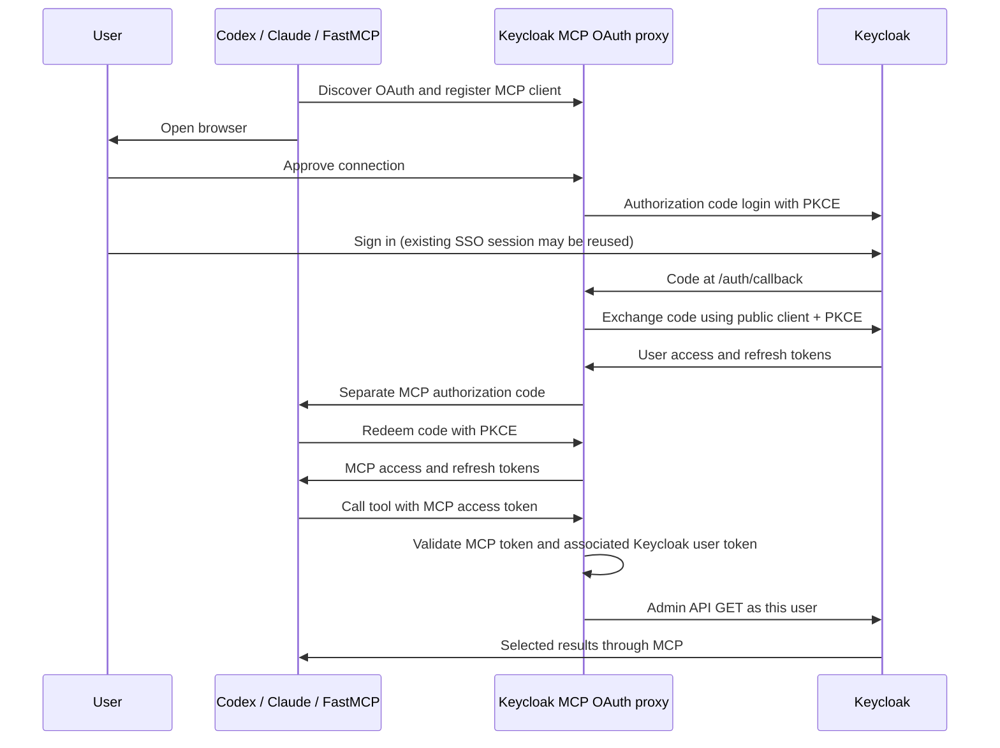

# Browser OAuth with Keycloak

Codex, Claude Code, and the direct FastMCP client can authenticate users in their
browser. The server uses FastMCP’s OAuth proxy and keeps each user’s Keycloak tokens
separate. Configure the target and client once on the server; users provide their
identity through their MCP client’s login flow.

## Flow



The proxy issues tokens for the MCP resource and stores the upstream user tokens
encrypted on disk. Tools receive the verified upstream token from the current
request’s authentication context. Sending a raw Keycloak token directly to `/mcp` is
rejected. The SDK does not log in as a service account or retry with another identity.
Standard Keycloak token exchange is not required for this flow.

## Register the Keycloak client

Use client ID `keycloak-mcp`, display name `Keycloak MCP`:

| Setting | Value |
| --- | --- |
| Access type | Public (client authentication disabled) |
| Standard flow | Enabled |
| PKCE method | S256 |
| Refresh tokens | Enabled |
| Implicit flow, direct access grants, service accounts | Disabled |
| Valid redirect URI | `http://localhost:5001/auth/callback` |
| Default client scopes | `profile`, `email`, `roles` |
| Access-token audience mapper | `keycloak-mcp`, the client's own ID (access token only) |

Example with the [Keycloak Terraform provider](https://registry.terraform.io/providers/keycloak/keycloak/latest/docs):

```hcl
resource "keycloak_openid_client" "keycloak_mcp" {
  realm_id  = "myrealm"
  client_id = "keycloak-mcp"
  name      = "Keycloak MCP"

  access_type                  = "PUBLIC"
  standard_flow_enabled        = true
  implicit_flow_enabled        = false
  direct_access_grants_enabled = false
  pkce_code_challenge_method   = "S256"
  full_scope_allowed           = true

  valid_redirect_uris = ["http://localhost:5001/auth/callback"]
}

# Put the client itself in `aud` so the server only accepts tokens minted for it.
resource "keycloak_openid_audience_protocol_mapper" "keycloak_mcp_audience" {
  realm_id                 = "myrealm"
  client_id                = keycloak_openid_client.keycloak_mcp.id
  name                     = "keycloak-mcp-audience"
  included_client_audience = keycloak_openid_client.keycloak_mcp.client_id
  add_to_access_token      = true
  add_to_id_token          = false
}
```

No client secret is required.

The Keycloak callback is the fixed **proxy** callback above. Codex and Claude callbacks
use random loopback ports; they register with the proxy, not directly with Keycloak.
The default proxy allowlist accepts `http://localhost:*/*` and
`http://127.0.0.1:*/*`. For other MCP clients, configure an explicit
`KEYCLOAK_OAUTH_CLIENT_REDIRECT_URIS` JSON list. Remote deployments require HTTPS and
an updated exact Keycloak callback URI.

Full scope allowed forwards the user’s existing role mappings into the token.
The client assigns no roles. The MCP tools perform GET requests only, but the user token
retains that user’s existing permissions. Users still need the corresponding
`realm-management` view/query permissions or fine-grained Admin API authorization.
A successful login alone does not grant access to realm, user, group, or client data.

## Configure the server

Copy `.env.example` to `.env` if it does not already exist, then set:

```dotenv
ENABLE_AUTH=True
MCP_HOST_ENDPOINT=http://localhost:5001
KEYCLOAK_SERVER_URL=https://keycloak.example.com
KEYCLOAK_REALM=myrealm
KEYCLOAK_OAUTH_CLIENT_ID=keycloak-mcp
KEYCLOAK_OAUTH_SIGNING_KEY=<persistent random key>
KEYCLOAK_OAUTH_AUDIENCE=keycloak-mcp
KEYCLOAK_OAUTH_SCOPES="openid profile email"
KEYCLOAK_OAUTH_STORAGE_DIR=.keycloak-oauth
# KEYCLOAK_CA_BUNDLE=/path/to/trusted-ca-bundle.pem
```

Leave `KEYCLOAK_OAUTH_CLIENT_SECRET` unset for a public client. The proxy sends
`client_id` and the PKCE verifier to Keycloak without client authentication. Refresh
requests also contain no client secret. Supplying `KEYCLOAK_OAUTH_CLIENT_SECRET` selects
`client_secret_basic` for confidential upstream clients; it does not change PKCE.

Generate the internal MCP signing key once:

```bash
uv run python -c 'import secrets; print(secrets.token_urlsafe(48))'
```

Keep the key private and stable. It signs MCP tokens and derives the storage
encryption key. Losing or changing it invalidates existing sessions and prevents
reading old encrypted state. Keep `.env` and `.keycloak-oauth/` out of version control.
The storage directory is created with mode `0700`. This configuration is for a
single server instance with persistent local storage; replicas need a shared store
and shared signing key before deployment.

Remove `KEYCLOAK_DEV_ACCESS_TOKEN`; the MCP client opens the browser. Startup rejects missing configuration or an insecure
non-loopback HTTP origin. No database is required.

TLS verification is enabled for authorization-code exchange, refresh, JWKS lookup,
and Admin API requests. If the system does not trust your Keycloak's certificate
issuer (for example a private CA), set `KEYCLOAK_CA_BUNDLE` to a PEM bundle containing
the trusted issuer certificates.

Your realm's discovery document is:

```text
https://keycloak.example.com/realms/myrealm/.well-known/openid-configuration
```

`KEYCLOAK_SERVER_URL` is the base URL before `/realms`; do not append `/admin/realms`
or an OIDC endpoint. Current Keycloak serves realms at the root; legacy WildFly
distributions and some deployments add an `/auth` context path, which must then be
part of the base URL.

Restart with `make local`, then follow the [Codex or Claude commands](../README.md)
or run the direct client:

```bash
uv run python examples/keycloak_client.py --oauth --username alice
```

## Validation and renewal

Upstream JWT verification checks RS256 signatures using the realm’s JWKS, issuer,
audience, authorized party (`azp=keycloak-mcp`), access-token type (`typ=Bearer`),
subject, expiry, not-before, and the `openid` scope. The proxy validates MCP tokens
separately. It enforces PKCE, one-use authorization codes, consent, and a callback
bound to the browser that approved the connection.

The MCP client requests refreshes. The proxy refreshes the associated Keycloak user
token and issues replacement MCP credentials. Rejected/expired upstream credentials
require signing in again. JWT validation is local; realm logout/revocation is not
checked by introspection on every call and may take effect at token expiry.

`tests/test_keycloak_oauth.py` exercises the full flow against simulated Keycloak endpoints:
public and confidential registration, browser consent and callback, PKCE failure, code replay, two concurrent
user identities, permissions, refresh, encrypted storage, invalid JWT claims, and
rejection of raw upstream tokens. This does not replace a live browser login test.

## Troubleshooting

| Symptom | Check |
| --- | --- |
| Startup lists missing `KEYCLOAK_*` values | Complete the server’s private OAuth settings |
| No browser login/discovery | Check `ENABLE_AUTH=True`, restart server, then run the MCP client’s login command |
| `invalid_client` during login | Verify the client exists in the realm, the client ID matches, and client authentication is disabled; leave the local client secret unset |
| Invalid redirect URI | Register exactly `http://localhost:5001/auth/callback` in Keycloak |
| Certificate verification failure | Configure the trusted CA bundle; keep verification enabled |
| Login succeeds but MCP reports authentication failure | Check the audience mapper matches `KEYCLOAK_OAUTH_AUDIENCE`, and the realm, scopes, and client ID |
| Tool reports missing permissions | Grant appropriate permissions to the user through normal Keycloak administration |

`ENABLE_AUTH=False` exposes discovery/tools without MCP authentication and no OAuth
endpoints. An optional localhost-only development token is described in
[Keycloak tools](keycloak-tools.md). Cursor compatibility flags do not relax the new proxy’s PKCE checks.

References: [MCP authorization](https://modelcontextprotocol.io/specification/2025-11-25/basic/authorization),
[FastMCP OAuth proxy](https://gofastmcp.com/servers/auth/oauth-proxy).
